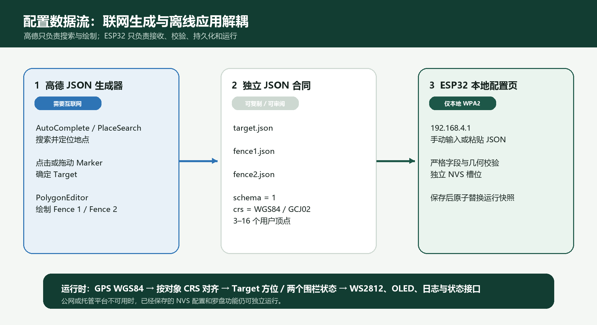
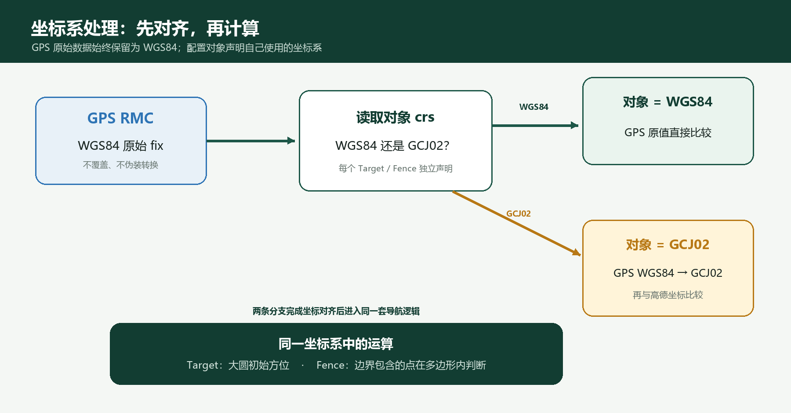
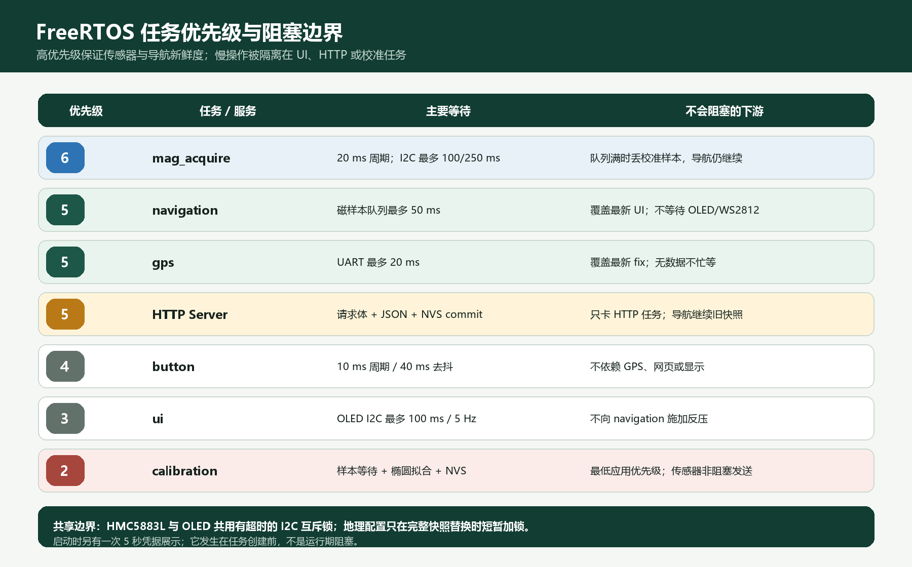

# MinecraftCompass Target 与电子围栏配置方案

> 文档版本：1.0  
> 对应固件：ESP-IDF 5.5.5 / ESP32-S3  
> 编制日期：2026-08-28

## 1. 结论先行

本次已经在现有罗盘固件中加入可构建的本地配置系统：设备创建 WPA2 SoftAP，用户连接后打开 `http://192.168.4.1`，可分别配置一个 Target 和最多两个电子围栏。三个对象各自使用独立 JSON、独立 HTTP 接口和独立 NVS 键；保存一个槽位不会覆盖另外两个，保存成功后立即生效，重启后自动恢复。

推荐把系统拆成两个互不依赖的页面：

1. **ESP32 本地配置页**：已经嵌入固件，不使用公网、CDN 或第三方脚本；负责手工坐标、矩形围栏、JSON 粘贴、严格校验和 NVS 保存。
2. **高德地图 JSON 生成器**：以后单独做成需要联网的电脑/手机网页；负责地点搜索、地图点击、拖动 Target、绘制与编辑任意多边形，然后导出本项目 JSON。生成后再连接 ESP32 热点粘贴 JSON。

这种拆分不要求 ESP32 一边开热点一边访问高德，也不把高德 Key 或安全密钥放入固件。Codex Sites 不是本方案的必需条件；面向中国大陆使用时，优先考虑本机工具或经实际网络验证的中国大陆 HTTPS 部署。



## 2. 已实现范围

### 2.1 固件与页面

- `main/config_portal.c`：SoftAP、随机密码、HTTP Server、安全响应头、REST 接口和请求大小限制。
- `main/config_page.html`：完全内嵌的响应式中文配置页，无外部字体、脚本、图片或 CDN。
- `main/geo_config.c`：JSON 解析、严格校验、NVS、WGS84→GCJ02、目标解析和点在多边形内判断。
- `main/main.c`：Target 模式读取运行时配置；导航循环持续判断两个围栏并记录状态变化。
- `main/oled_display.c`：启动时显示热点 SSID、随机密码和 `192.168.4.1` 约 5 秒。
- `main/ui_service.c`：Target 被禁用时显示 `TARGET:NOT SET`。

### 2.2 当前运行行为

- `NORTH` 模式仍使用 HMC5883L 航向和当前 27 组实测角度区间。
- `TARGET` 模式使用 GPS 当前坐标和 NVS Target 计算大圆初始方位。
- Target 不可用、GPS 过期或磁力计不可用时，导航状态为 `status:0`，WS2812 使用现有无效状态旋转动画。
- Fence 1 / Fence 2 独立判断 `unconfigured`、`disabled`、`unknown`、`outside`、`inside`。
- 围栏边界按 `inclusive` 处理，即 GPS 点恰在边上也算 `inside`。
- 当前围栏结果通过串口状态变化日志与 `/api/v1/status` 暴露；固件没有擅自把围栏结果绑定到某种 LED、蜂鸣器或报警动作。

## 3. 使用步骤

1. 上电后查看 OLED 或 ESP-IDF Terminal：SSID 形如 `MCCompass-A1B2`，密码是首次启动生成并写入 NVS 的 16 位随机字符。
2. 手机或电脑连接该 WPA2 热点。
3. 浏览器打开 `http://192.168.4.1`。本地页面不需要互联网。
4. 在 Target、Fence 1、Fence 2 中任选一种方式：
   - 直接填写坐标；围栏手工方式用 A、B 两个角点生成矩形；
   - 粘贴完整独立 JSON；多边形可为 3–16 个顶点。
5. 点击保存。只有当 ESP32 端校验、NVS 写入和 `nvs_commit()` 都成功后，页面才报告成功并替换运行时快照。

浏览器检查用于提前给出友好提示，**ESP32 端检查才是最终可信边界**。即使绕过网页直接调用接口，也不能跳过服务器校验。

## 4. JSON 合同

### 4.1 Target

```json
{
  "schema": 1,
  "type": "target",
  "id": "target",
  "name": "天安门",
  "enabled": true,
  "crs": "GCJ02",
  "coordinate": {
    "lat": 39.908722,
    "lon": 116.397499
  }
}
```

### 4.2 Fence 1

```json
{
  "schema": 1,
  "type": "polygon",
  "id": "fence1",
  "name": "示例区域",
  "enabled": true,
  "crs": "GCJ02",
  "boundary": "inclusive",
  "vertices": [
    { "lat": 39.9092, "lon": 116.3968 },
    { "lat": 39.9092, "lon": 116.3982 },
    { "lat": 39.9082, "lon": 116.3982 },
    { "lat": 39.9082, "lon": 116.3968 }
  ]
}
```

Fence 2 的结构相同，但 `id` 必须是 `fence2`，并提交到 `/api/v1/fence/2`。禁用围栏时，推荐使用空 `vertices` 数组（不是强制；固件也接受禁用状态下的 3–16 个合法顶点，但仍拒绝 1–2 个点）：

```json
{
  "schema": 1,
  "type": "polygon",
  "id": "fence2",
  "name": "",
  "enabled": false,
  "crs": "WGS84",
  "boundary": "inclusive",
  "vertices": []
}
```

### 4.3 字段和限制

| 字段 | 规则 | 原因 |
|---|---|---|
| `schema` | 必须为整数 `1` | 允许以后演进格式，并拒绝未知版本 |
| `id` | 必须与槽位严格一致 | 防止把 Fence 1 JSON 错写到 Fence 2 |
| `name` | UTF-8 最多 32 字节；启用时不可为空 | 限制 RAM、NVS 和页面输出大小 |
| `crs` | 仅 `WGS84` 或 `GCJ02` | 防止两种坐标系静默混用 |
| `lat` | 有限数，`-90…90` | 合法纬度范围 |
| `lon` | 有限数，`-180…180` | 合法经度范围；JSON 中始终经度字段 `lon` |
| `vertices` | 启用时 3–16 点；禁用时推荐空数组，也可保留 3–16 个合法点 | 限制计算量和 JSON 大小；空数组减少歧义 |
| 多边形 | 顶点唯一、有面积、不自交，包围框不超过 `2° × 2°` | 排除不可信和误粘贴数据 |
| 未知/重复字段 | 拒绝 | 防止拼写错误被悄悄忽略 |
| HTTP 请求体 | 1–3072 字节 | 限制单请求内存占用 |

16 点和 2° 包围框都是**本项目 v1 的工程约束**，不是高德 PolygonEditor 的官方限制。边界表达只支持一个外环：本项目 JSON 不支持 holes（内环）或 MultiPolygon；GeoJSON 或 `getPath()` 返回嵌套路径、多环或多个多边形时应拒绝，不能静默只取第一环。GeoJSON 的闭合环可能在末尾重复首点；转换成本项目 JSON 时应删除末尾重复点，因为本项目把每个用户顶点只保存一次，并在判断时自动闭合末边。

## 5. NVS 与一致性

| 命名空间 | 键 | 内容 |
|---|---|---|
| `mc_geo` | `target` | Target 规范 JSON |
| `mc_geo` | `fence1` | Fence 1 规范 JSON |
| `mc_geo` | `fence2` | Fence 2 规范 JSON |
| `mc_net` | `ap_psk` | 16 位随机热点密码 |
| `mc_compass` | `cal2d` | 原有二维椭圆校准记录 |

写入顺序是“解析和几何校验 → 生成规范 JSON → `nvs_set_str` → `nvs_commit` → 短时间持有配置互斥锁替换完整快照 → revision 加一”。因此 NVS 失败时旧配置继续工作，导航任务不会看到半个多边形。

固件刻意不采用参考 WiFi 测试工程中“初始化失败就 `nvs_flash_erase()`”的恢复方式，因为全擦除会同时删除校准、Target、围栏和热点密码。NVS 不可用时罗盘仍以编译期 Target 回退运行，但配置接口保持只读失败语义。

## 6. 坐标系处理



本项目把设备 GPS/NMEA RMC 输出的原始经纬度按 WGS84 处理；“RMC = WGS84”是设备/项目接口前提，不是高德文档对 RMC 报文的专门承诺。高德官方称 WGS84 是 GPS 设备常用坐标系，地图侧使用 GCJ-02（“火星坐标”）；为避免偏移，二者在中国大陆不应直接混用（工程结论）。本固件 JSON 中的 `crs` token `GCJ02` 即对应官方名称 `GCJ-02`。固件遵循以下规则：

- WGS84 Target / Fence：GPS 原值直接用于方位或围栏判断。
- GCJ02 Target / Fence：GPS WGS84 在 RAM 中转换成 GCJ02 后再比较；原始 GPS 数据不被覆盖。
- 同一对象内部只允许一种 `crs`，不能只修改 `crs` 字符串来假装完成转换。

高德官方提供 GPS/WGS84 到高德/GCJ-02 的正向转换能力，例如 `AMap.convertFrom(position, "gps", callback)`，并说明单次最多 40 对坐标。若由后端批量转换，可用[Web 服务坐标转换文档](https://lbs.amap.com/api/webservice/guide/api/convert)及其[官方接口地址](https://restapi.amap.com/v3/assistant/coordinate/convert)，使用 `coordsys=gps`；Web Service Key 不应下发浏览器。固件中的离线转换是工程实现，不是从官方 SDK 复制到设备的功能；正式产品应选取中国大陆多地测试点，与高德官方转换结果建立误差基线，并确认适用法规和业务合规要求。

## 7. 高德 JS API JSON 生成器方案

### 7.1 能否搜索后直接得到多边形？

普通 `AMap.AutoComplete` / `AMap.PlaceSearch` 主要提供提示/POI 名称、地址和 `location` 点坐标；官方参考未提供把任意 POI 直接返回场地多边形边界的接口，因此“不能自动得到可靠边界”是基于接口能力的工程判断，而非高德对每个 POI 的绝对声明。可行且清晰的交互是：

1. 输入地点名称，由 `AMap.AutoComplete` 给提示；选中后用 `AMap.PlaceSearch` 定位并把地图居中。
2. Target 可直接采用 POI 的 `location`，或让用户点击地图、拖动 Marker 微调。
3. 围栏以搜索结果为视觉中心，再用 `AMap.PolygonEditor` 手工绘制/编辑真实边界。
4. 保存前调用 `polygon.getPath()`，转换为普通 `{lat, lon}` 数组，并在应用代码中执行 3–16 点、无重复首尾点等产品校验。

因此，“搜索”解决找到地方，“PolygonEditor”解决给出多边形；两者组合，而不是期待 POI 搜索自动猜测边界。

### 7.2 推荐页面流程

```text
输入提示/POI 搜索
        ↓
地图居中 + 可拖动 Target Marker
        ↓
新建或编辑 Fence 1 / Fence 2 Polygon
        ↓
读取单一外环 getPath()，拒绝 holes/MultiPolygon，去掉闭合重复点，检查 3–16 点
        ↓
导出三个彼此独立的 GCJ02 JSON
        ↓
连接 ESP32 热点，分别粘贴并保存
```

核心伪代码：

```js
// 实际项目应先配置服务端安全代理，见 7.3。
const autoComplete = new AMap.AutoComplete({ input: "keyword" });
const placeSearch = new AMap.PlaceSearch({ map });

autoComplete.on("select", event => {
  const poi = event.poi ?? event;
  if (poi.location) setTargetMarker(poi.location);
  if (poi.name) placeSearch.search(poi.name);
});

map.on("click", event => setTargetMarker(event.lnglat));
targetMarker.on("dragend", () => exportTarget(targetMarker.getPosition()));

const editor = new AMap.PolygonEditor(map, polygon);
editor.open();

function exportFence(slot, polygon) {
  const path = polygon.getPath();
  if (!Array.isArray(path) || path.length === 0 || Array.isArray(path[0])) {
    throw new Error("仅支持一个非空外环，不支持 holes 或 MultiPolygon");
  }
  const points = path.map(p => ({ lat: p.getLat(), lon: p.getLng() }));
  if (points.length >= 2 && samePoint(points[0], points[points.length - 1])) {
    points.pop();
  }
  if (points.length < 3 || points.length > 16) {
    throw new Error("本项目仅接受 3–16 个用户顶点");
  }
  return {
    schema: 1, type: "polygon", id: slot, name: "",
    enabled: true, crs: "GCJ02", boundary: "inclusive",
    vertices: points
  };
}
```

相关高德官方资料：

- [输入提示与 POI 搜索](https://lbs.amap.com/api/javascript-api-v2/guide/services/autocomplete)
- [AutoComplete 参考](https://lbs.amap.com/api/maps-javascript-api/reference/search/autocomplete)
- [PlaceSearch 参考](https://lbs.amap.com/api/maps-javascript-api/reference/search/placesearch)
- [地图与覆盖物事件](https://lbs.amap.com/api/javascript-api-v2/guide/events/map_overlay)
- [Marker 参考](https://lbs.amap.com/api/maps-javascript-api/reference/amap-marker/marker)
- [多边形绘制和编辑](https://lbs.amap.com/api/javascript-api-v2/guide/amap-polygon/polygon)
- [PolygonEditor 参考](https://lbs.amap.com/api/maps-javascript-api/reference/tool/polygoneditor)
- [Polygon / getPath 参考](https://lbs.amap.com/api/maps-javascript-api/reference/vector/polygon)
- [GeoJSON 覆盖物参考](https://lbs.amap.com/api/maps-javascript-api/reference/vector/geojson)
- [其他坐标转高德坐标](https://lbs.amap.com/api/javascript-api-v2/guide/transform/convertfrom)
- [Web 服务坐标转换文档](https://lbs.amap.com/api/webservice/guide/api/convert)
- [Web 服务坐标转换接口](https://restapi.amap.com/v3/assistant/coordinate/convert)

### 7.3 Key、安全密钥和发布

高德 JS API 2.0 的浏览器页面需要“Web端（JS API）”Key；如果还要从后端调用 REST 坐标转换，应另外创建“Web服务”Key。两者不要混用。

生产环境不要把安全密钥写成网页中的 `securityJsCode`。高德官方更推荐代理模式：页面只声明 `window._AMapSecurityConfig.serviceHost`，安全密钥由自己的服务端代理保存；`_AMapService` 路径前缀按官方要求保留。JS Key 在浏览器网络请求中可见是正常现象，但要绑定真实部署域名；Web Service Key/签名私钥只能放后端，并可绑定服务器出口 IP。

推荐按使用规模选择：

| 场景 | 建议 | 取舍 |
|---|---|---|
| 个人开发/少量配置 | 本机运行一个小型前后端服务，浏览器打开 localhost；后端代理高德安全密钥 | 不必公开发布，部署最少，但电脑要联网 |
| 中国大陆正式用户 | 选择大陆网络实测良好的 HTTPS 主机，配置真实域名、代理、域名/IP 白名单 | 需要域名、证书、后端维护；上线前应做目标运营商实测 |
| 只使用 ESP32 | 不加载高德；在本地页手输 Target/矩形或粘贴离线 JSON | 最安全、最稳定，但没有地图搜索和自由绘制 |
| Codex Sites | 可用于原型，但不作为本项目大陆生产可达性的默认承诺 | 仍需验证大陆网络与是否支持所需安全代理 |

高德官方说明 JS API 应通过其 HTTPS 在线地址加载，不应下载后与本地代码混合打包。官方资料：[JS API 准备](https://lbs.amap.com/api/javascript-api-v2/prerequisites)、[安全密钥代理](https://lbs.amap.com/api/javascript-api-v2/guide/abc/jscode)、[JS API 加载](https://lbs.amap.com/api/javascript-api-v2/guide/abc/load)、[Web 服务 Key](https://lbs.amap.com/api/webservice/create-project-and-key)、[域名错误 FAQ](https://lbs.amap.com/faq/js-api/map-js-api/create-project/46515)。

事实边界：高德官方资料说明 JS API 在线 HTTPS 加载及 PC/移动端适配，但没有承诺任一中国大陆运营商、浏览器或托管平台的连通性。由此只能推断：目标大陆浏览器能访问 `webapi.amap.com`、HTTPS 页面和自有安全代理，且 Key、域名/IP 白名单配置正确时，地图、搜索和绘制在技术上可行；实际可达性与稳定性仍须用目标网络实测。上表“中国大陆正式用户”和 “Codex Sites” 的可用性描述属于部署建议/推断，不是高德官方保证。

## 8. 本地热点安全评估

当前实现适合原型和物理可控设备：

- 首次启动随机生成 16 位 WPA2 密码，不使用所有设备相同的固定口令。
- 密码独立存于 NVS，重启不变；HTTP 状态接口不会返回密码。
- 页面没有 CDN、第三方脚本、跨域授权或公网请求。
- 写接口仅接受 `application/json`，限制 3072 字节，并检查浏览器 `Origin`。
- HTTP JSON body 接收设置 10 秒总截止时间，socket timeout 最多重试 3 次；超限返回 408，避免慢请求长期占用 HTTPD；动态错误 JSON 由 cJSON 生成并转义。
- 响应设置 `no-store`、`nosniff`、`DENY`、`no-referrer` 和 CSP。

仍需理解的边界：

- `http://192.168.4.1` 没有应用层 HTTPS；链路保密依赖 WPA2。已获得热点密码的客户端都可修改配置。
- SSID/密码在启动 OLED 和串口日志中可见，属于“能接触设备的人可配网”的信任模型。
- SoftAP 当前一直开启，会增加功耗和攻击面。量产版建议改为“长按按键进入配置模式”或“上电后开放 5 分钟”，并提供恢复密码的物理流程。
- 当前没有账户、角色、审计日志或 TLS 证书管理，不适合暴露到互联网或桥接到不可信局域网。
- 不应把高德安全密钥、Web Service Key 或签名私钥写入 ESP32 页面或固件。

## 9. FreeRTOS 优先级和阻塞性



| 任务/服务 | 优先级 | 栈 | 主要等待/阻塞 | 影响评估 |
|---|---:|---:|---|---|
| `mag_acquire` | 6 | 4096 | 20 ms 周期；I2C 取锁最多 100 ms，重配最多 250 ms | 最高应用优先级；采样队列写入不等待 |
| `navigation` | 5 | 4096 | 等新磁样本最多 50 ms | 拥有航向滤波、Target bearing、围栏判断和 status 选择 |
| `gps` | 5 | 4096 | UART 读取最多 20 ms | 无数据时不忙等；只覆盖最新 fix |
| HTTP Server | 5（IDF 默认） | 8192 | 接收请求体、JSON、NVS 提交 | 只阻塞 HTTP 任务；NVS 写入期间导航继续使用旧快照 |
| `button` | 4 | 2048 | 10 ms 周期 | 40 ms 去抖；不依赖网页或 GPS |
| `ui` | 3 | 4096 | OLED I2C 取锁最多 100 ms；约 5 Hz | WS2812/OLED 慢不会反压 navigation |
| `calibration` | 2 | 8192 | 等样本并执行椭圆拟合/NVS | 最低应用优先级；采样生产者用非阻塞发送 |

共享关系：

- HMC5883L 与 OLED 共用 `i2c_mutex`。访问有超时，避免永久互锁。
- 导航、GPS、模式和 UI 使用长度为 1 的 latest-value 队列，旧值可被覆盖，优先保证新鲜度。
- 校准队列容量 64；满时磁传感器任务丢弃校准样本，不影响导航。
- 地理配置使用独立互斥锁。NVS 写入不持有此锁；只有完整配置替换时短暂加锁。
- 启动阶段有一次 5 秒热点凭据 OLED 展示，任务尚未创建，这是明确的启动等待，不是运行期阻塞。

## 10. 构建结果与容量

2026-08-28 在实际工程上执行：

```text
idf.py reconfigure build size
ESP-IDF 5.5.5 / target esp32s3
MinecraftCompass.bin = 0xEDB80 bytes
1 MiB app 分区剩余 = 0x12480 bytes（约7%）
Total image size = 973577 bytes
```

编译和链接通过，未出现源代码告警。当前分区可以烧录，但 7% 余量不适合继续大幅加入 TLS、OTA 或大型网页资源。下一阶段若继续扩展，建议切换 ESP-IDF 自带的 `Single factory app (large), no OTA` 1.5 MiB 分区，并确认硬件 Flash 容量；若需要 OTA，则应先重新做 Flash/分区容量设计，不能同时假设 2 MiB Flash、双 OTA 分区和接近 1 MiB 的应用都能容纳。

## 11. 验收建议

### 11.1 页面与 NVS

- 分别保存 Target、Fence 1、Fence 2，重启后逐个读取并比较规范 JSON。
- 保存 Fence 1 后确认 Fence 2 和 Target 的 revision 内容未被覆盖。
- 提交空坐标、`NaN` 字符串、纬度 91、经度 181、未知 CRS、错误 id、17 点、重复点、自交“蝴蝶结”和超过 2° 的围栏，确认返回 4xx 且旧值仍生效。
- 断电重启，确认热点密码不变；NVS 初始化异常时确认固件没有自动全擦除。

### 11.2 坐标与围栏

- 选择至少 5 个中国大陆测试点，把固件 WGS84→GCJ02 结果与高德官方转换结果比对并记录误差。
- 对每个多边形测试明显内部、明显外部、顶点、水平边、斜边各一点。
- 用实机 GPS 缓慢跨越边界，观察状态。RMC 不含 HDOP/水平精度，边界附近可能因定位抖动来回切换；若围栏要触发报警，建议后续增加时间去抖、距离迟滞和定位精度门槛。

### 11.3 实机并发

- 手机持续刷新配置页，同时旋转设备，确认 WS2812 导航无明显停顿。
- OLED 与 HMC5883L 同总线连续运行 30 分钟，检查 I2C 超时和重试日志。
- 在 JSON 保存、校准 NVS 保存、GPS 输入同时发生时做长时间运行测试。
- 测试两个客户端同时连接；当前 HTTPD 单任务串行处理写请求，后到请求应基于提交顺序覆盖同一槽位。

## 12. 已知限制和后续优先级

1. **P0：实机坐标转换验证。** 离线 WGS84→GCJ02 必须用官方结果建立测试基线。
2. **P0：容量决策。** 继续加入功能前切换 1.5 MiB 单应用分区或换更大 Flash；如需 OTA 重新设计分区。
3. **P1：配置模式开关。** 长按 GPIO5 或新增按键动作，仅在授权窗口开启 SoftAP。
4. **P1：围栏稳定器。** 解析支持精度信息的 NMEA 语句，加入精度阈值、连续样本确认和距离迟滞。
5. **P1：高德生成器原型。** 搜索、Target Marker、两个 PolygonEditor、三个独立 JSON 导出和本地后端安全代理。
6. **P2：业务动作。** 由产品需求明确 `inside/outside` 对 LED、蜂鸣器、日志或无线通知的行为；当前仅提供状态，不猜测报警语义。
7. **P2：配置导入导出版本迁移。** schema 2 出现时保留 schema 1 迁移器和回滚策略。

---

本方案的核心原则是：设备本地页负责“安全地接收和持久化”，高德联网页负责“直观地搜索和绘制”，两者只通过独立、可审阅的 JSON 连接。这样即使公网或某个托管平台不可用，已经生成的配置和设备本身仍可正常工作。
